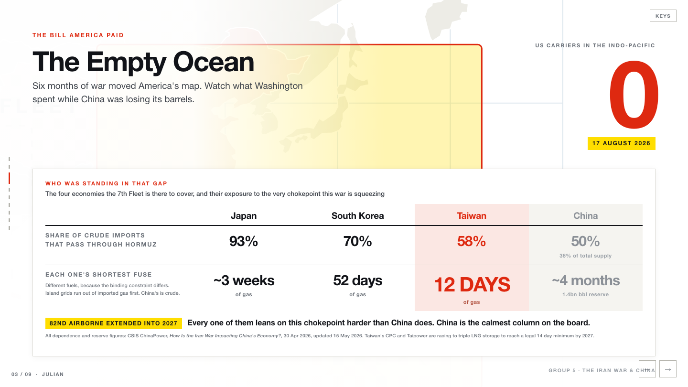
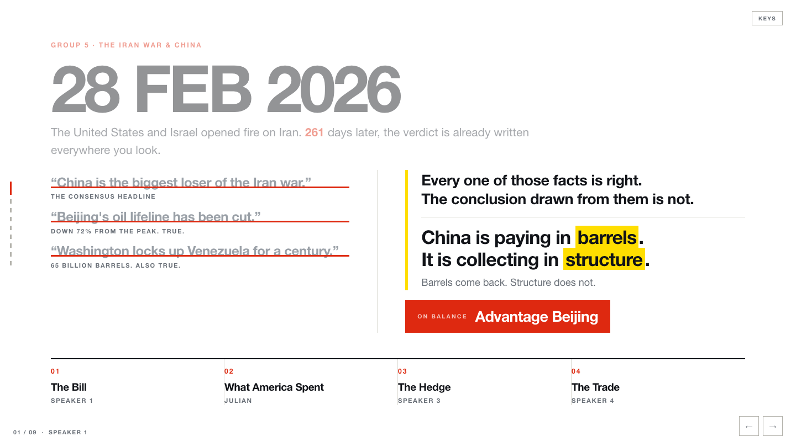
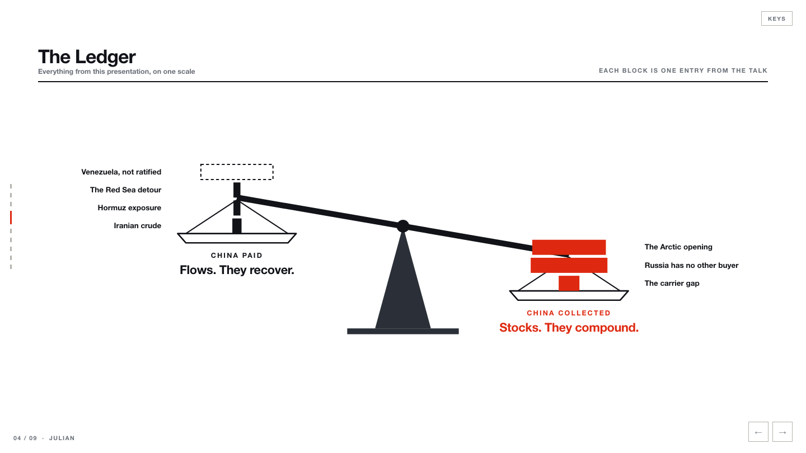
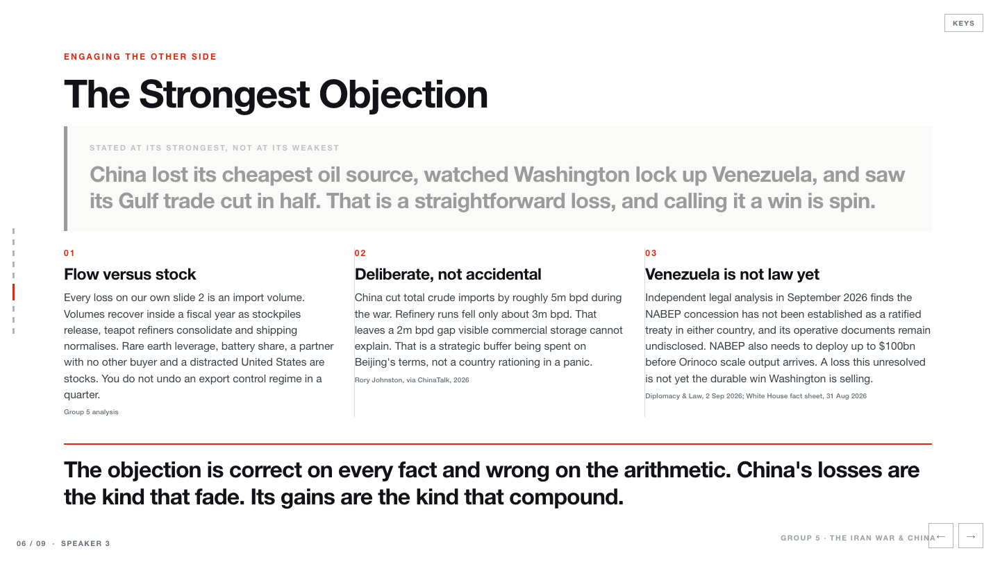
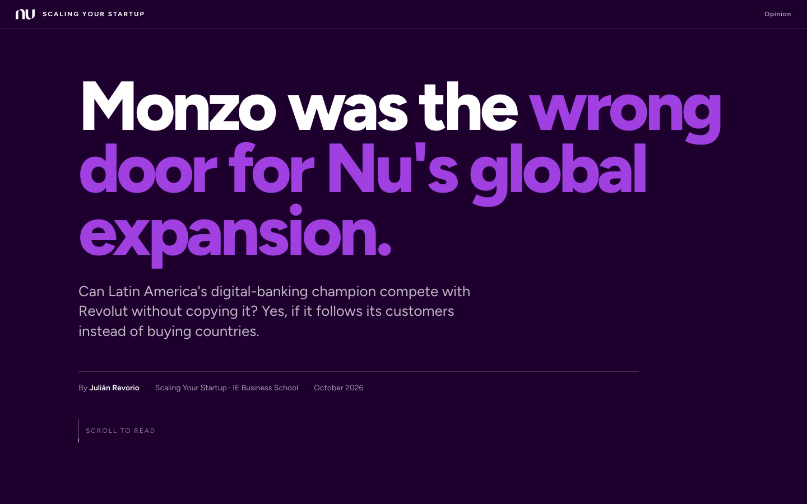
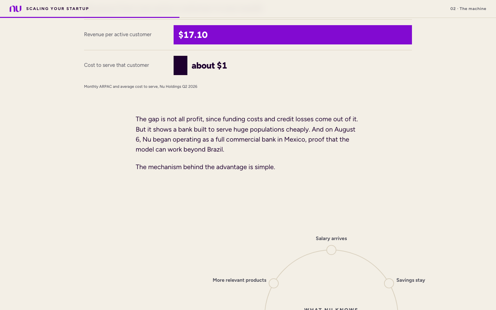

# Presentations Creator

A **design system, writing rules and build process for single-file HTML presentations**: decks that open offline with a double click, reveal one idea at a time, draw their charts in code, and can be edited in place in the browser.

Instead of a template, the project is a written standard (the [design playbook](docs/design-playbook.md)) plus two reference decks built to it. The decks are authored with an AI model that reads the playbook, proposes an outline for approval, builds the HTML and runs a QA checklist.

**Status:** two reference examples and a playbook. There is no generator or template yet: the deck engine (stage scaling, step reveals, edit mode, keyboard navigation) is embedded in each file, and the playbook says to extract templates once five or six decks exist.

## The two examples

Both are business school assignments, built on public data. Open the HTML files directly in a browser.

| | |
|---|---|
| **[Argument deck](examples/china-iran-war-argument-deck.html)**: 9 slides, four speakers, English. A thesis is shown, struck through and replaced; the strongest objection is stated at its strongest and answered; a recurring visual (a ledger that gains a block per section and finally tips) resolves in the close. Here, *The Empty Ocean*: a live counter, a map and a four-column comparison on one slide. |  |
| |  |
| **The same deck, mid-talk.** Charts, maps and the ledger are inline SVG/CSS in the deck's own type and colours, with one idea revealed per step. |  |
| |  |
| **[Scroll article](examples/nubank-scroll-article.html)**: a magazine-style page instead of slides, with sticky graphics, sliders and a phone demo, in the colours of the company it analyses. |  |
| |  |

The scroll article is an independent class assignment about a public company. It is not affiliated with or endorsed by Nubank; the name and colours are used to analyse it.

## What the standard says

Ten non-negotiables, from [docs/design-playbook.md](docs/design-playbook.md):

1. Client brand first; a neutral house style only when there is no client.
2. Few boxes: structure from type size, whitespace and hairline rules, not cards.
3. Visual over verbal: if a slide reads from its headline plus one visual, it is right.
4. One idea per slide or step; long content is revealed step by step.
5. Every number has a source and a date; illustrative numbers are labelled.
6. Headlines are claims, not topics.
7. No hyphens or dashes in deck text (rewrite instead).
8. Spanish is Latin American Spanish, addressed to *ustedes*.
9. **Outline first**: no HTML is built until the outline is approved.
10. One self-contained HTML file that works offline.

The playbook also covers the colour system (colour is meaning, not decoration), the type scale, layouts without boxes, motion rules, brand research with sourced findings, deck types (proposal, demo, argument, scroll article, workshop), the technical standard and a QA checklist.

## Technical standard (what the playbook requires)

- Fixed 1440×810 stage scaled to the window, letterboxed.
- Slides on a horizontal track; `data-beats` / `data-b` mark step-by-step reveals, and going back a step reverses cleanly.
- **Edit mode:** opening with `?editar` makes all text editable in place and offers "Save and download", which writes a clean new HTML file. The scroll article implements it; the argument deck was built before it became part of the standard.
- Keyboard navigation, clickable slide rail, slide counter, `prefers-reduced-motion` respected.
- Fonts, logos and images embedded; no CDN dependencies.

## Try it

Open [`examples/china-iran-war-argument-deck.html`](examples/china-iran-war-argument-deck.html) and use → / Space to advance, ← to go back, `End` to complete a slide. Open [`examples/nubank-scroll-article.html`](examples/nubank-scroll-article.html) and scroll; append `?editar` to its URL to try edit mode.

## Licence

The decks in `examples/` and their screenshots are [CC BY 4.0](LICENSE-CC-BY-4.0.txt): reuse them with attribution. Third-party logos, names and data inside them are not covered. The playbook and this README are [MIT](LICENSE).

## Notes

- Client decks built with the same system are not part of this repository.
- On the argument deck, which was presented by four speakers, the section labels read "Speaker N" instead of names; the content is otherwise as delivered.

---

Part of [AI Build Log](https://github.com/julianreves/ai-build-log) · by [Julián Revorio](https://www.linkedin.com/in/julianrevorio/)
